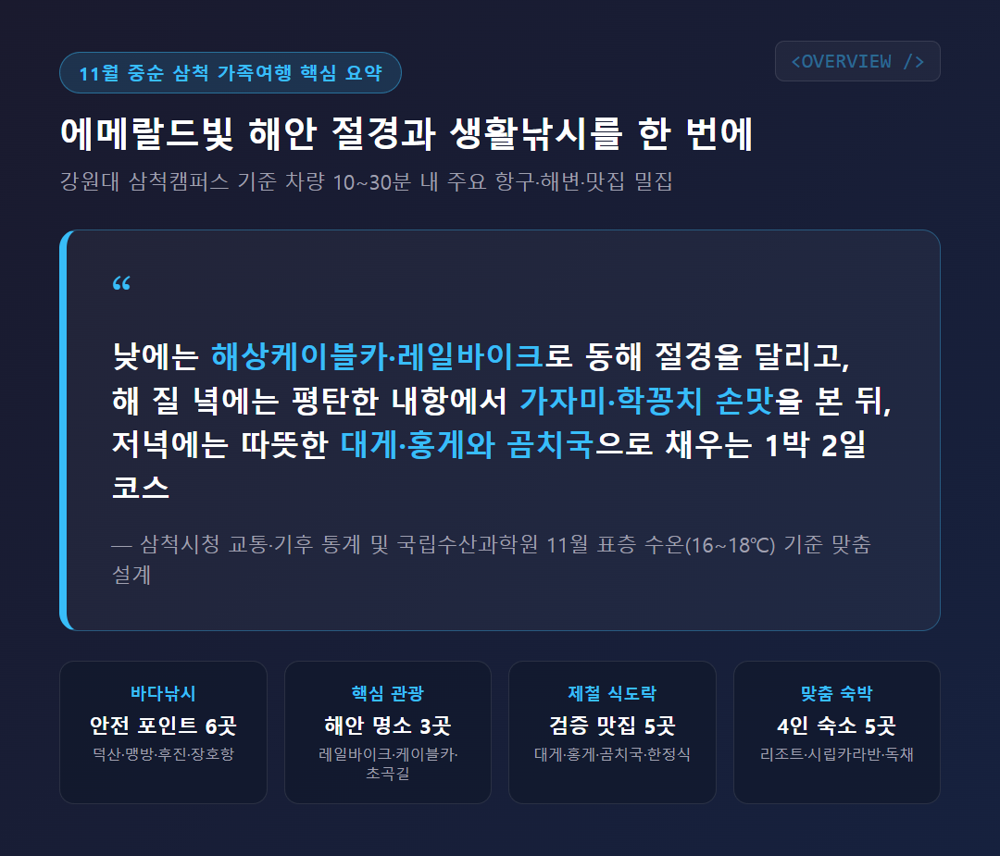
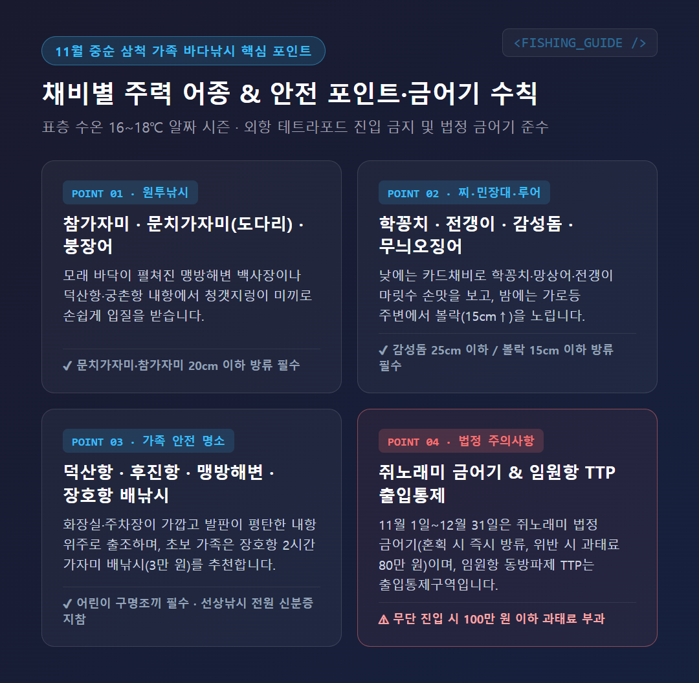
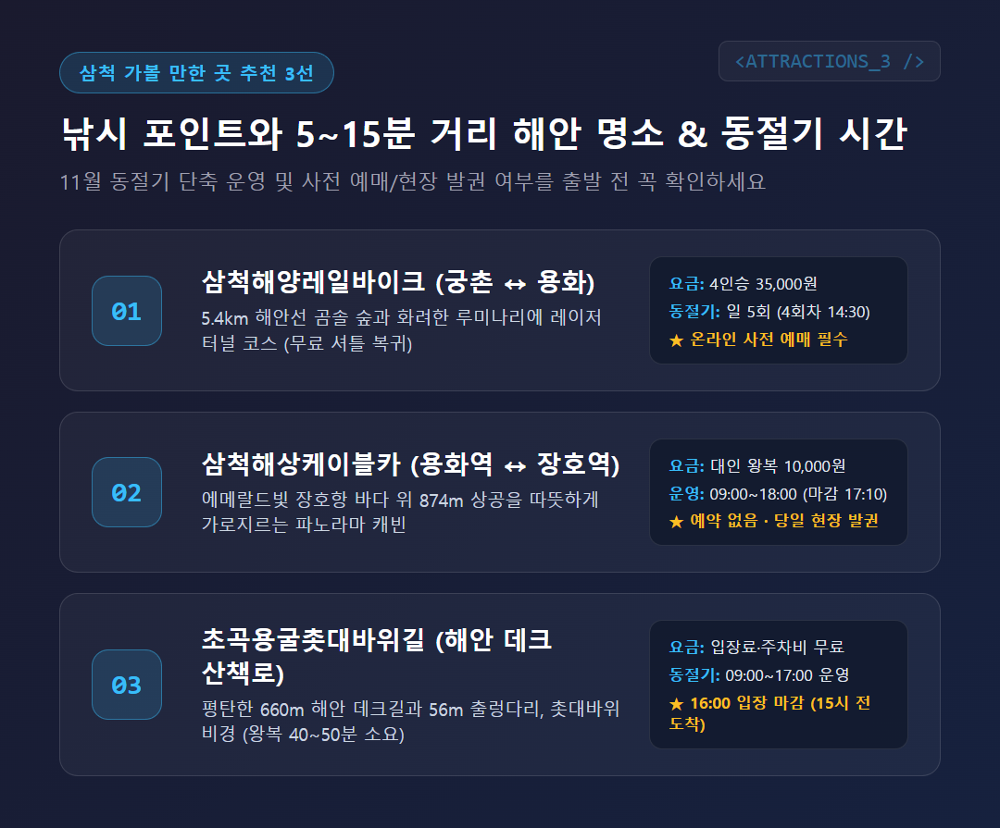
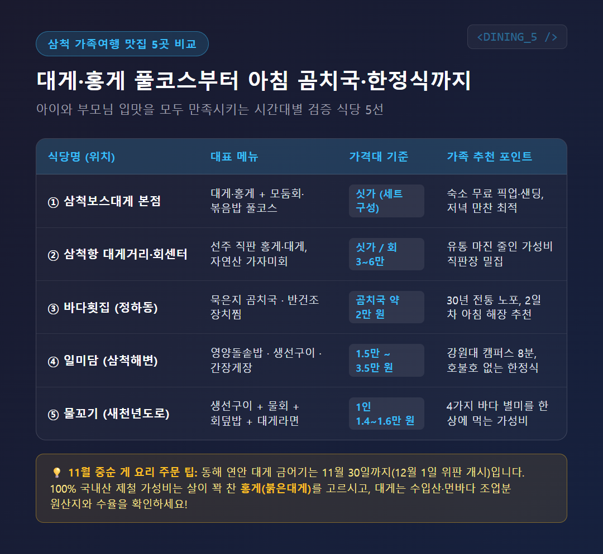
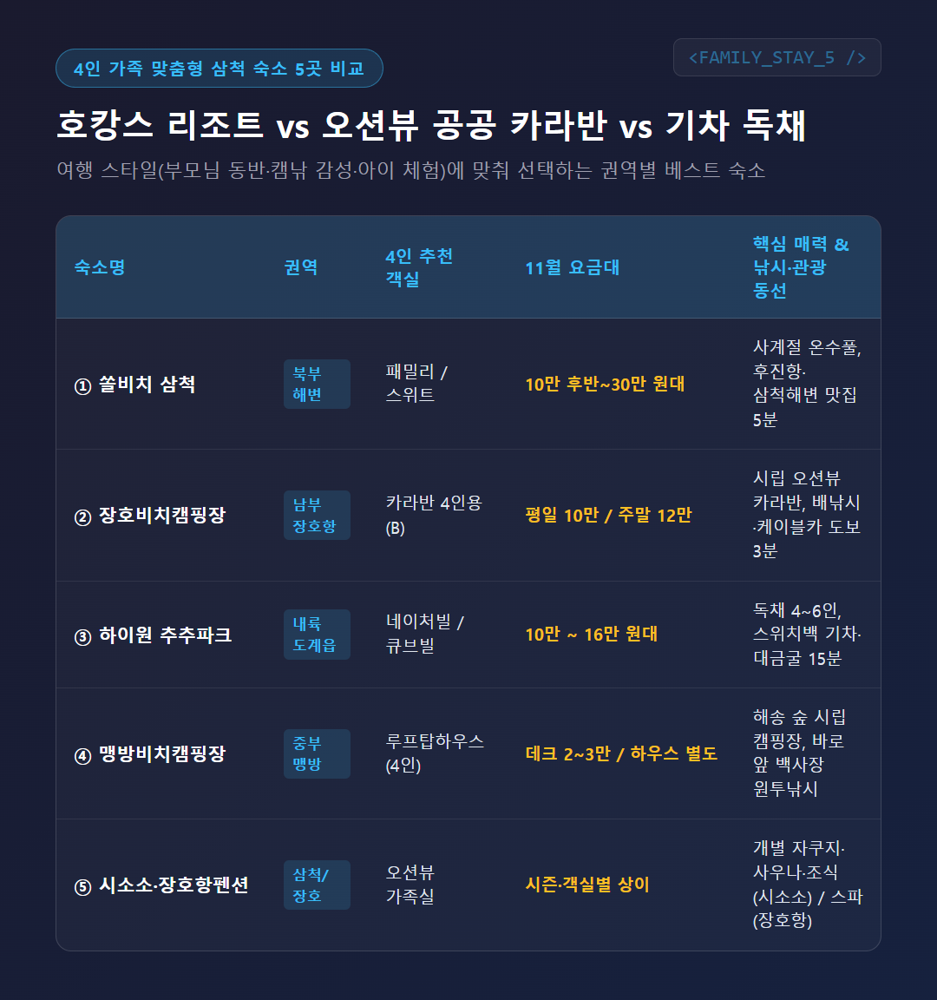
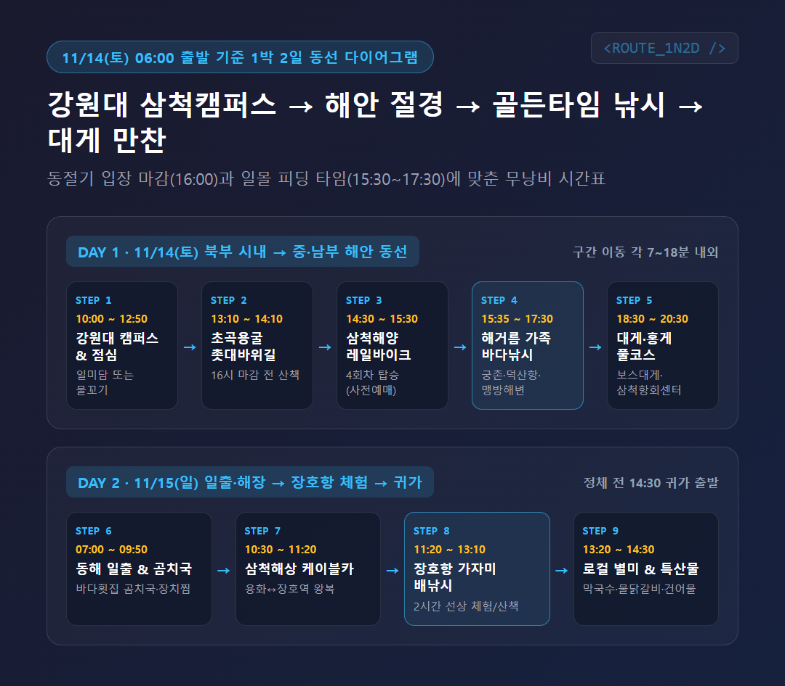
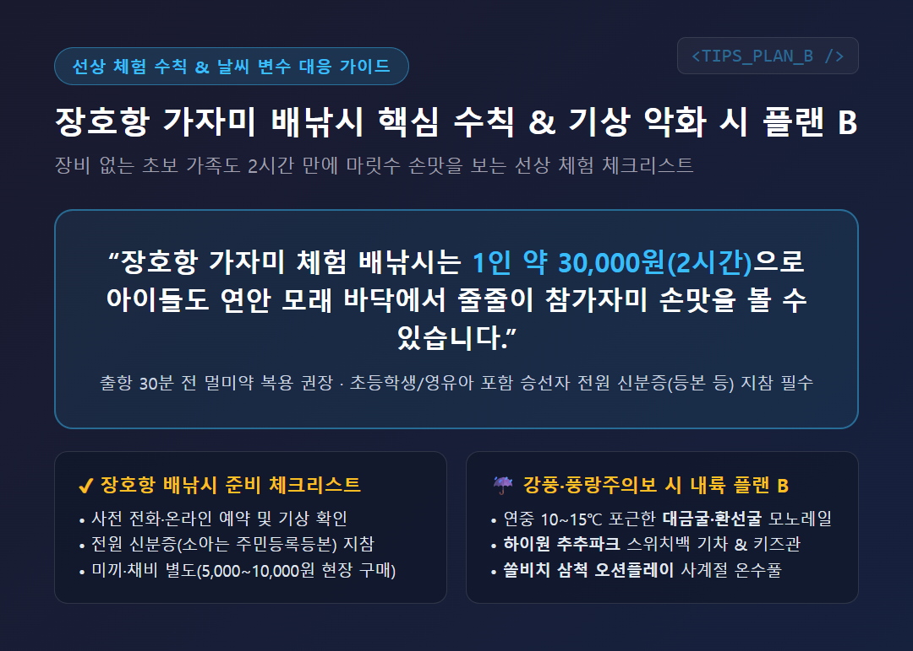

# 11월 삼척 가족여행 1박 2일 코스, 바다낚시와 대게 맛집·숙소 총정리

저는 가족여행을 갈 때 욕심을 부려 일정을 빽빽하게 채우는 것을 별로 좋아하지 않습니다. 특히 부모님이나 아이들과 함께 움직이면서 바다낚시와 관광, 식사까지 모두 챙기려면 이동 동선에서 진이 빠지기 쉬운데요. 그래서 이번 11월 중순 **삼척 가족여행** 코스는 이동 시간 낭비를 줄이고 '제철 손맛'과 '식도락'에만 집중할 수 있도록 처음부터 다르게 짜보기로 했습니다.

결론부터 말씀드리면 — 11월 중순의 삼척은 가족 단위로 생활낚시와 해안 절경 관광을 함께 즐기기에 가장 알맞은 시기입니다. 삼척시청 교통 안내와 해양 자료를 보면, 첫 목적지인 강원대학교 삼척캠퍼스를 기준으로 주요 해변과 항구, 맛집이 차로 10분에서 30분 안에 모두 모여 있기 때문인데요. 오늘 글에서는 11월 중순에 꼭 알아야 할 바다낚시 어종과 금어기 주의사항부터 가볼 만한 곳 3곳, 대게를 포함한 맛집 5곳, 4인 가족 숙소 5곳, 그리고 11월 14일 오전 6시 출발 기준 1박 2일 시간대별 일정표까지 한 번에 정리해 드립니다.

---

## 1. 11월 중순 삼척 바다낚시, 어떤 어종이 잡히고 어디가 안전할까요?

솔직히 말씀드리면, 초겨울 문턱인 11월 중순에 아이들을 데리고 바다낚시를 가는 것이 망설여질 수도 있습니다. 삼척시청 기후 통계를 보면 11월 평균기온은 약 15.5℃로 낮에는 15~20℃ 안팎이라 활동하기 좋지만, 아침저녁에는 5~9℃ 이하로 떨어지고 북서풍이 불어 체감온도는 초겨울처럼 쌀쌀한데요. 하지만 국립수산과학원과 현지 조황 자료를 보면 이 시기 표층 수온은 16~18℃를 유지해, 겨울 산란기를 앞둔 물고기들이 살을 찌우며 활발하게 입질하는 '알짜 시즌'이기도 합니다.

### 11월 중순 주요 대상 어종과 낚시 방법

가족 단위 생활낚시에서는 채비에 따라 노릴 수 있는 어종이 확실히 나뉩니다. 복잡한 장비 없이도 손맛을 볼 수 있는 방법은 크게 세 가지인데요.

- **원투낚시 (방파제 내항·백사장)**: 모래 바닥이 펼쳐진 해변이나 방파제에서 청갯지렁이 미끼를 던져두면 **참가자미, 문치가자미(도다리), 기름가자미**가 잘 올라옵니다. 해가 진 뒤에는 염장 고등어나 오징어살 미끼에 **붕장어(아나고)** 입질도 꾸준한 편입니다.
- **찌낚시·민장대·카드채비 (방파제)**: 크릴 밑밥을 조금씩 뿌리며 카드채비나 민장대를 드리우면 **학꽁치, 망상어, 전갱이(메가리), 고등어**가 무리를 지어 반응해 아이들도 쉽게 마릿수 손맛을 볼 수 있습니다. 수온이 받쳐주는 날에는 가을 성수기 어종인 **감성돔, 벵에돔, 임연수어**도 기대할 수 있습니다.
- **루어낚시 (에깅·라이트게임)**: 가을 시즌 막바지인 11월 중순까지는 굵은 씨알의 **무늬오징어**가 낚이며, 밤 시간대 방파제 가로등 주변에서는 소형 지그헤드와 웜으로 **볼락**을 노리기 좋습니다. (참고로 서·남해에서 인기인 갑오징어는 삼척 연안의 주력 어종이 아니며, 동해안 11월 두족류는 무늬오징어와 돌문어가 중심입니다.)

### 모르면 과태료 80만 원! 쥐노래미 금어기와 금지체장 주의사항

낚싯대를 펼치기 전에 반드시 먼저 확인해야 할 법적 기준이 있습니다. 국가법령정보센터의 「수산자원관리법 시행령」과 국립수산과학원 기준을 보면, 일반 비어업인이 금어기나 금지체장 규정을 어길 경우 80만 원의 과태료가 부과되는데요. **특히 11월 1일부터 12월 31일까지는 '쥐노래미(돌삼치)'의 법정 금어기입니다.** 원투낚시를 하다 보면 쥐노래미가 자주 올라오는데, 11월 중순에는 크기에 상관없이 잡는 즉시 바다로 돌려보내야 합니다.

| 어종명 | 법정 금어기 | 법정 금지체장 (이하 포획 금지) | 11월 중순 삼척 출조 시 핵심 주의사항 |
| :--- | :--- | :--- | :--- |
| **쥐노래미** | **11월 1일 ~ 12월 31일** | 20cm 이하 | **11월 중순 포획 절대 금지** (혼획 시 즉시 방류) |
| **문치가자미(도다리)** | 12월 1일 ~ 익년 1월 31일 | **20cm 이하** | 11월 중순 포획 가능하나 **20cm 이하 방류 필수** |
| **참가자미** | 없음 | **20cm 이하** | **20cm 이하 방류 필수** |
| **감성돔** | 5월 1일 ~ 5월 31일 | **25cm 이하** | 11월 포획 가능, **25cm 이하 방류 필수** |
| **볼락** | 없음 | **15cm 이하** | 연중 포획 가능, **15cm 이하 방류 필수** |
| **붕장어** | 없음 | **35cm 이하** | 연중 포획 가능, **35cm 이하 방류 필수** |
| **학꽁치·벵에돔·무늬오징어** | 없음 | 없음 | 법정 제한 없음 (단, 어린 개체는 자율 방류 권장) |

문치가자미(도다리)는 12월 1일부터 금어기가 시작되므로 11월 중순에는 포획할 수 있습니다. 하지만 문치가자미와 참가자미 모두 몸길이 **20cm 이하**는 잡으면 안 되니 줄자를 꼭 챙기시길 권해 드립니다.

### 아이와 함께 가기 좋은 안전한 가족 낚시 포인트 6곳

초보자나 아이 동반 가족이라면 파도가 직접 들이치는 외항 테트라포드(TTP)는 무조건 피해야 합니다. 실제로 동해해양경찰서 고시 자료를 보면 **임원항 동방파제 테트라포드 구역은 공식 '출입통제구역'**으로 지정되어 있어, 무단 진입 시 100만 원 이하의 과태료가 부과되는데요. 화장실과 주차장이 가깝고 발판이 평평한 가족 맞춤형 포인트는 다음과 같습니다.

1. **덕산항 (덕산방파제)**: 삼척시청 관광 안내에서도 손꼽는 근덕면 대표 생활낚시터로, 내항 발판이 평탄하고 공중화장실과 주차장, 낚시점, 회센터가 한곳에 모여 있어 가족 단위로 가장 편리합니다.
2. **맹방해변 (백사장 원투낚시)**: 넓고 완만한 모래사장이라 아이들이 모래놀이를 하는 동안 부모가 원투낚싯대를 세워두고 도다리와 가자미를 낚는 '캠낚(캠핑+낚시)' 명소이며, 무료 주차장과 화장실이 잘 갖춰져 있습니다. (인근 원평해변도 도다리가 잘 낚이지만 철길을 건너야 하고 11월에는 화장실 이용이 불편할 수 있어 맹방해변이 더 유리합니다.)
3. **후진항 (후진방파제)**: 쏠비치 삼척과 삼척해수욕장에서 차로 3~5분 거리에 있는 아담한 항구로, 방파제 턱이 낮아 아이들과 민장대나 카드채비로 학꽁치·전갱이를 낚기에 안성맞춤입니다.
4. **궁촌항**: 삼척해양레일바이크 궁촌정거장 바로 앞이라 관광 전후로 들르기 좋으며, 안전한 내항 석축에서 원투낚시와 야간 볼락 루어낚시를 즐길 수 있습니다.
5. **삼척항 및 초곡항**: 시내에서 가장 가까운 삼척항(정라항)과 초곡용굴촛대바위길 입구의 초곡항 역시 주차장과 화장실이 가깝고 내항 난간에서 안전하게 낚싯대를 드리울 수 있습니다.
6. **장호항 어촌체험휴양마을 (선상 가자미 배낚시)**: 바다여행 포털과 선상 예약 자료를 보면, 낚시 장비가 전혀 없는 가족에게는 장호항의 **2시간 가자미 체험 배낚시(1인 약 30,000원, 미끼·채비 5,000~10,000원 별도)**가 확실한 대안입니다. 연안 모래 바닥에서 입질이 빨라 아이들도 줄줄이 손맛을 볼 수 있는데요. 단, 어린이와 영유아를 포함한 **전원 신분증(등본 등)** 지참과 사전 예약이 필수이며, 출항 30분 전에는 멀미약을 챙겨 드셔야 합니다.

[경험 보강 필요: 덕산항 내항이나 맹방해변에서 가족과 함께 원투낚싯대를 거치해 둔 현장 느낌이나 아이들 구명조끼 착용 모습 등 짧은 경험담 추가]

---

## 2. 삼척 가볼 만한 곳 추천 3곳, 11월 동절기 운영시간은?

낚시만 하기에는 삼척의 해안 절경이 너무 아깝습니다. 앞서 살펴본 낚시 포인트(궁촌항·장호항·초곡항)와 차로 5~15분 거리에 붙어 있어 이동 부담 없이 묶어 갈 수 있는 대표 명소 3곳을 골랐는데요. 11월은 동절기 단축 운영이 적용되는 곳이 있으니 운영시간과 예약 방식을 꼭 확인하셔야 합니다.

### ① 삼척해양레일바이크 (궁촌정거장 ↔ 용화정거장)

한국관광공사와 공식 홈페이지 안내를 보면, 약 5.4km의 해안선을 따라 곰솔 숲과 기암괴석을 달리는 삼척의 대표 가족 코스로 꼽힙니다. 특히 코스 중간에 화려한 레이저 쇼가 펼쳐지는 '루미나리에 및 해저 도시 테마 터널'을 지나가기 때문에 아이들이 지루해할 틈이 없는데요. 편도로 약 1시간 동안 탑승한 뒤 도착 정거장에서 무료 셔틀버스를 타고 출발지 주차장으로 편하게 돌아올 수 있습니다.

- **위치**: 강원특별자치도 삼척시 근덕면 공양왕길 2 (궁촌정거장) / 용화정거장
- **이용 요금**: 2인승 25,000원 / **4인승 35,000원** (4인 가족이 1대에 함께 탈 수 있어 경제적입니다.)
- **11월(동절기) 운영시간**: 하루 5회차 운영 (1회 09:00 / 2회 10:30 / 3회 13:00 / **4회 14:30** / 5회 16:00, 매월 둘째·넷째 주 수요일 휴무)
- **예약 방법**: 주말에는 현장 구매가 사실상 어려우므로 [삼척해양레일바이크 공식 홈페이지](https://www.oceanrailbike.com)에서 사전 인터넷 예매가 필수입니다.

### ② 삼척해상케이블카 (용화역 ↔ 장호역)

용화해변에서 '한국의 나폴리'라 불리는 장호항까지 에메랄드빛 바다 위 874m를 가로지르는 케이블카입니다. 11월 중순에는 바닷바람이 차갑지만, 사방이 막힌 캐빈 안에서 따뜻하게 발아래 펼쳐진 투명한 바다와 기암괴석을 감상할 수 있다는 점이 큰 장점인데요. 레일바이크 용화정거장 바로 옆이 케이블카 용화역이고, 반대편 장호역에 내리면 바로 장호항 배낚시 체험장으로 이어져 동선이 깔끔하게 떨어집니다.

- **위치**: 강원특별자치도 삼척시 근덕면 삼척로 2154-31 (용화역) ↔ 장호항길 12 (장호역)
- **이용 요금**: 대인 왕복 10,000원(편도 6,000원) / 소인(만 36개월~초등학생) 왕복 6,000원(편도 4,000원)
- **11월 운영시간**: 09:00 ~ 18:00 (매표 마감 17:10, 매월 첫째·셋째 주 화요일 휴무, 강풍 시 조기 마감 가능)
- **예약 방법**: 인터넷 예약 없이 **당일 현장 발권**으로만 운영됩니다.

### ③ 초곡용굴촛대바위길 (해안 데크 산책로)

수십 년 동안 군사통제구역으로 묶여 있다가 개방된 해안 비경으로, 주차비와 입장료가 모두 무료입니다. 총길이 660m의 평탄한 해안 데크길과 56m 길이의 출렁다리를 걸으며 촛대바위, 거북바위, 피라미드바위를 왕복 40~50분 만에 가볍게 둘러볼 수 있어 어르신이나 어린아이도 걷기 편한데요. **단, 11월 동절기에는 오후 4시(16:00)에 입장이 마감**되므로 반드시 오후 3시 이전에 도착하도록 일정을 잡아야 합니다.

- **위치**: 강원특별자치도 삼척시 근덕면 초곡길 236-4 (초곡항 바로 옆)
- **이용 요금**: 무료 (주차 및 입장료 전면 무료)
- **11월(동절기) 운영시간**: 09:00 ~ 17:00 (**입장 마감 16:00**, 매주 월요일 휴무 및 풍랑주의보 시 통제)
- **날씨 변수 팁**: 만약 여행 당일 비가 오거나 바닷바람이 너무 매섭다면, 해안 산책로 대신 연중 내부 온도가 10~15℃로 포근한 내륙의 **대금굴**(100% 사전 인터넷 예매제, 성인 12,000원)이나 **환선굴**(현장 발권 가능, 성인 입장료 4,500원·모노레일 왕복 7,000원 별도)로 변경하시는 것을 추천합니다.

---

## 3. 삼척 가족여행 맛집 5곳, 11월 대게와 제철 향토음식은 어디서 먹을까요?

금강산도 식후경인데, 4인 가족이 움직일 때는 아이들이 잘 먹는 메뉴와 어른들이 좋아하는 제철 해산물의 균형을 맞추는 것이 중요합니다. 한국관광공사와 식객 맛집 리포트, 삼척시청 자료를 바탕으로 대게·홍게 전문점부터 아침 해장 노포, 가성비 한상까지 실패 없는 5곳을 추렸습니다.

### ① 삼척보스대게 본점 (대게·홍게·킹크랩 풀코스)

삼척해수욕장과 쏠비치 삼척 인근에 자리한 대게 코스 전문점입니다. 메인 대게찜만 나오는 것이 아니라 활어 모둠회(전복회 포함), 갈릭 왕새우 버터구이, 오징어순대, 백골뱅이구이, 물회 또는 물닭갈비, 게딱지 볶음밥, 홍게라면까지 한 상 가득 풀코스로 차려져 가족 외식 만족도가 높은 곳인데요. 인근 숙소 투숙객을 위한 **무료 픽업·샌딩 서비스**를 운영하고 있어 저녁 식사 때 차를 두고 편하게 다녀올 수 있습니다.

- **위치 및 영업시간**: 삼척시 테마타운길 39 (교동) / 11:00 ~ 21:30 (브레이크타임 15:30~16:30, 화요일 휴무)
- **대표 메뉴 및 가격**: 보스세트·빅보스세트 **싯가** (수율·시세에 따라 변동, 2~4인 가족 기준 약 10만 원대 후반~20만 원대 중후반 선)

### ② 삼척항 대게거리 & 삼척항회센터 (선주 직판 홍게·대게)

항구 특유의 활기찬 분위기에서 가성비 있게 게 요리와 자연산 회를 즐기고 싶다면 삼척항 회센터와 대게거리가 제격입니다. '동승호'처럼 실제 조업하는 어선 이름을 내건 선주 직판장들이 모여 있어 유통 마진을 줄인 가격에 싱싱한 갑각류와 당일 낚은 자연산 참가자미·도다리 회(소~대 30,000~60,000원 선)를 맛볼 수 있는데요.

여기서 11월 중순 방문객이 꼭 알아두어야 할 점이 하나 있습니다. 일부 여행 미디어에서는 '11월부터 삼척 대게 철이 시작된다'고 소개하지만, 국가법령정보센터의 수산자원관리법 시행령을 보면 국내 동해 연안 대게의 금어기는 6월 1일부터 11월 30일까지(단, 동경 131도 30분 동쪽 먼바다 수역은 11월 1일부터 일부 조업 허용)라 본격적인 연안 햇대게 위판은 12월 1일부터 시작됩니다. 그래서 11월 중순에 100% 국내산 제철 맛과 가성비를 챙기시려면 살이 꽉 찬 **'홍게(붉은대게)'**를 주력으로 고르시고, 묵직한 대게를 원하신다면 러시아산 수입 대게나 먼바다 조업 대게인지 원산지와 수율을 확인하고 주문하시는 것이 현명합니다.

- **위치**: 삼척시 이사부길 38 (정하동, 삼척항회센터) 및 새천년도로 대게거리 일원

### ③ 바다횟집 (30년 전통 곰치국·장치찜 노포)

《식객 허영만의 백반기행》에도 소개된 삼척항 인근의 30년 전통 향토 음식점입니다. 11월 찬 바람이 불 때 생각나는 대표 별미인 **곰치국(물잠뱅이국)**은 잘 익은 묵은지와 무를 넣고 칼칼하게 끓여내는데, 부드러운 곰치 살이 입안에서 '사르르' 녹아내려 아침 식사나 해장으로 그만인데요. 반건조 장치를 매콤달콤하게 조려 살이 쫀득한 **장치찜**도 밥도둑 메뉴로 꼽힙니다. 단, 곰치는 바다 날씨가 나쁘면 잡히지 않는 날도 있으니 방문 전에 전화(033-574-3543)로 당일 곰치국 판매 여부를 꼭 확인해 보세요.

- **위치 및 영업시간**: 삼척시 새천년도로 88 (정하동) / 아침 식사 가능 ~ 저녁 (매주 수요일 휴무)
- **대표 메뉴 및 가격**: 곰치국 1인 약 20,000원 선 / 장치찜·가자미회(중·대) 약 40,000~60,000원 선

### ④ 일미담 (영양돌솥밥·생선구이·간장게장 가족 한정식)

자극적인 음식이나 날것(회)을 먹지 못하는 어린아이, 그리고 정갈한 한식을 선호하는 부모님이 함께할 때 가장 무난하고 든든한 식당입니다. 주문 즉시 지어내는 고소한 영양돌솥밥과 누룽지를 기본으로 바삭한 모둠 생선구이, 직화 불고기, 간장게장, 전복장 등이 정갈하게 차려지는데요. 강원대 삼척캠퍼스에서 차로 8분 거리이고 주차장과 홀이 넓어 첫날 점심 코스로 넣기에 딱 좋습니다.

- **위치 및 영업시간**: 삼척시 테마타운길 49 (교동, 삼척해변 인근) / 11:00 ~ 21:00
- **대표 메뉴 및 가격**: 돌솥 B정식 15,000원 / 돌솥 A정식 17,000원 / 돌솥 특정식 22,000원 / 일미담 스페셜 정식 35,000원

### ⑤ 물꼬기 (생선구이·물회·대게라면 가성비 한상)

새천년해안도로 초입에 위치한 곳으로, 1인 1만 원대 중반이라는 합리적인 가격에 바다 별미 네 가지를 한 번에 맛볼 수 있는 가성비 맛집입니다. 대표 메뉴인 '물꼬기한상'을 주문하면 노릇하게 구운 **모둠 생선구이 한판과 살얼음 동동 띄운 물회, 회덮밥, 그리고 얼큰한 대게라면**이 한꺼번에 나오는데요. 재료 소진 시 일찍 마감될 수 있고 수요일은 쉬는 경우가 많아 첫날이나 둘째 날 점심 식사로 방문하시는 것을 추천합니다. (만약 다른 로컬 별미를 원하신다면 백김치에 싸 먹는 수육과 막국수로 유명한 **부일막국수**나 국물이 칼칼한 **성원물닭갈비**도 훌륭한 선택지입니다.)

- **위치**: 삼척시 새천년도로 53-1, 1층 (정하동)
- **대표 메뉴 및 가격**: 물꼬기한상(2인 이상 주문) 1인 약 14,000~16,000원 선

[경험 보강 필요: 소개된 식당 중 직접 방문해 본 곳의 밑반찬 맛이나 가족들의 반응 한두 줄 추가]

---

## 4. 4인 가족에게 딱 맞는 삼척 숙소 5곳 비교

4인 가족 숙소는 여행 스타일에 따라 선택지가 확연히 갈립니다. 편리한 부대시설을 원하시는지, 아니면 바닷가 바로 앞에서 '캠낚' 감성을 느끼고 싶으신지에 맞춰 고를 수 있도록 공식 홈페이지와 한국관광공사 숙박 정보를 토대로 5곳을 비교해 보았습니다.

| 숙소명 | 위치 권역 | 4인 가족 추천 객실 | 11월(비수기) 대략 요금대 | 핵심 매력 및 낚시·관광 연계성 |
| :--- | :--- | :--- | :--- | :--- |
| **① 쏠비치 삼척** | 북부 (갈천동) | 패밀리 / 스위트 (4~5인) | 1박 10만 원대 후반~30만 원대 | 사계절 온수 풀(오션플레이), 후진항(낚시)·삼척해변 맛집 5분 거리 |
| **② 장호비치캠핑장** | 남부 (장호항) | 카라반 4인용 (B구역) | 평일 100,000원 / 주말 120,000원 | 시립 오션뷰 카라반, 장호항 배낚시·해상케이블카 도보 2~3분 |
| **③ 하이원 추추파크** | 내륙 (도계읍) | 네이처빌 / 큐브빌 (독채 4~6인) | 1박 10만~16만 원대 선 | 스위치백 기차·키즈 체험, 대금굴·환선굴 차량 15~20분 거리 |
| **④ 맹방비치캠핑장** | 중부 (맹방해변) | 루프탑하우스(4인) / 데크 | 데크 2~3만 원대 / 하우스 별도 | 해송 숲 시립 캠핑장, 바로 앞 맹방해변 원투낚시·덕산항 5분 거리 |
| **⑤ 시소소 & 장호항 펜션** | 삼척해변 / 장호항 | 파노라마 오션뷰 가족실 | 시즌·객실별 상이 | 시소소(개별 자쿠지·사우나·조식) / 바다랑·아름다운펜션(스파·바비큐) |

- **호캉스와 편리한 인프라가 우선이라면 (① 쏠비치 삼척 & ⑤ 시소소)**: 부모님을 모시거나 어린 자녀가 있어 깔끔한 침구와 부대시설이 중요하다면 **쏠비치 삼척**이 가장 든든합니다. 차로 3~5분 거리에 후진항 방파제와 삼척보스대게, 일미담이 모여 있어 동선이 아주 짧은데요. 조금 더 프라이빗한 감성을 원하신다면 삼척해변 절벽 위에서 파노라마 오션뷰와 개별 자쿠지, 사우나, 조식을 즐길 수 있는 **시소소**(최대 5인)나 장호항 인근의 **바다랑펜션·아름다운펜션**도 좋은 평가를 받고 있습니다.
- **가성비 오션뷰 캠핑과 낚시가 목적이라면 (② 장호비치캠핑장 & ④ 맹방비치캠핑장)**: 삼척시에서 운영하는 공공 캠핑장 두 곳은 관리가 깨끗하고 가격이 합리적입니다. **장호비치캠핑장 4인용 카라반**은 주말에도 120,000원으로 침대와 냉난방기, 취사도구가 모두 갖춰져 있어 몸만 가도 캠핑 기분을 낼 수 있고, **맹방비치캠핑장 루프탑하우스**는 숙소 바로 앞 백사장에서 원투낚시를 즐기기에 최적입니다.
- **아이들 기차 체험과 동굴 탐험을 묶는다면 (③ 하이원 추추파크)**: 실제 기차를 개조한 트레인빌은 2~3인용이라 4인 가족에게는 독채 통나무형인 **네이처빌**이나 모던형인 **큐브빌**을 권해 드립니다. 단지 안에서 증기기관차 형태의 스위치백트레인과 레일바이크를 탈 수 있어 초등학생 이하 아이들이 특히 좋아합니다.

---

## 5. 11/14(토) 06시 출발 → 10시 강원대 삼척캠퍼스 도착 기준 1박 2일 일정표

이제 앞서 살펴본 모든 장소를 실제 시간표에 맞춰 배치해 보겠습니다. 첫날 오전 6시에 출발해 **오전 10시 정각에 강원대학교 삼척캠퍼스(삼척시 중앙로 346)에 도착**하는 일정인데요. 캠퍼스가 시내 중심에 있어 점심 식당가(삼척해변·삼척항)까지는 차로 7~10분, 남쪽 관광지(초곡·궁촌·장호항)까지는 15~30분이면 닿을 수 있습니다.

일정을 짤 때 제가 가장 신경 쓴 부분은 **'입장 마감 시간'**과 **'물때(피딩 타임)'** 두 가지입니다. 바다타임 조석 자료를 보면 동해안은 조수간만의 차가 20~30cm로 작아 언제든 낚시가 가능하지만, 물고기 입질이 가장 활발한 골든타임은 **일몰(17:12~17:15경) 전후인 오후 3시 30분~5시 30분 사이**인데요. 그래서 동절기 입장이 16시에 일찍 마감되는 초곡용굴촛대바위길과 해양레일바이크(14:30 회차)를 낮에 먼저 둘러보고, 해 질 녘 골든타임에 맞춰 방파제나 해변에서 가족 낚시를 즐기도록 동선을 맞췄습니다.

### [1일 차] 11월 14일(토) : 캠퍼스 방문 → 해안 비경 & 레일바이크 → 해거름 바다낚시 → 대게 만찬

- **06:00 ~ 10:00 | 출발 및 강원대학교 삼척캠퍼스 도착**
  - 수도권 기준 영동·동해고속도로를 이용해 오전 10:00 강원대 삼척캠퍼스(삼척시 중앙로 346)에 도착합니다.
- **10:00 ~ 11:30 | 강원대 삼척캠퍼스 일정 소화**
  - 예정된 캠퍼스 방문 일정을 여유 있게 마칩니다.
- **11:30 ~ 12:50 | 해안가 이동(차량 8분) 및 1일 차 점심 식사**
  - **선택 A (정갈한 가족 한정식)**: **일미담**에서 갓 지은 영양돌솥밥과 생선구이, 직화불고기, 간장게장 정식(1인 15,000~35,000원)으로 든든하게 식사합니다.
  - **선택 B (가성비 바다 한상)**: **물꼬기**에서 모둠 생선구이+살얼음 물회+회덮밥+대게라면이 나오는 '물꼬기한상'(1인 14,000~16,000원)을 맛봅니다.
- **12:50 ~ 13:10 | 남부 해안권(초곡항)으로 이동 (차량 약 18분)**
  - 식사 후 남쪽으로 내려가며 덕산항이나 궁촌항 인근 낚시점에 잠시 들러 청갯지렁이 미끼와 크릴 밑밥, 카드채비를 미리 챙깁니다.
- **13:10 ~ 14:10 | [명소 ①] 초곡용굴촛대바위길 해안 산책**
  - 동절기 입장 마감(16:00) 전에 도착해 가장 포근한 오후 햇살을 받으며 660m 해안 데크길과 출렁다리, 촛대바위를 왕복 50분간 산책합니다.
- **14:10 ~ 15:30 | 이동(차량 7분) 및 [명소 ②] 삼척해양레일바이크 탑승 (4회차 14:30)**
  - 사전 예매해 둔 14:30 회차(4인승 35,000원)에 탑승해 곰솔 숲 해안선과 화려한 루미나리에 터널을 달린 뒤 무료 셔틀버스로 출발지에 복귀합니다.
- **15:35 ~ 17:30 | [핵심 액티비티] 해거름 골든타임 가족 바다낚시 (약 2시간)**
  - 일몰(17:13경) 전후 피딩 타임에 맞춰 레일바이크 역 앞 **궁촌항 내항**, 또는 차로 5분 거리의 **덕산항 방파제**나 **맹방해변 백사장**에 자리를 잡습니다. (쏠비치 숙박 시 후진항 이동 가능)
  - 원투낚시로 도다리·참가자미를 노리고, 민장대·카드채비로 학꽁치·망상어를 낚으며 가족 모두 손맛을 봅니다. (**어린이 구명조끼·방한복 착용 필수, 쥐노래미는 즉시 방류!**)
- **17:30 ~ 18:10 | 4인 가족 숙소 체크인 및 재정비**
  - 예약한 숙소(쏠비치 삼척 / 장호비치캠핑장 카라반 / 맹방비치캠핑장 / 시소소·장호항 펜션)에 체크인하고 따뜻하게 손을 씻으며 휴식합니다.
- **18:30 ~ 20:30 | 1일 차 저녁 : 삼척 대게·홍게 풀코스 만찬**
  - **선택 A (무료 픽업 & 풀코스)**: **삼척보스대게 본점**에서 대게찜과 모둠회, 왕새우 버터구이, 오징어순대, 게딱지볶음밥, 홍게라면 풀코스를 즐깁니다.
  - **선택 B (선주 직판 & 제철 홍게)**: **삼척항 대게거리·회센터**에서 11월 제철 국산 홍게(붉은대게)나 대게찜, 자연산 가자미 세꼬시를 합리적인 싯가로 구매해 만찬을 즐깁니다.

### [2일 차] 11월 15일(일) : 동해 일출 & 곰치국 아침 → 해상케이블카 & 장호항 배낚시 → 별미 점심 후 귀가

- **06:50 ~ 08:30 | (선택) 동해 일출 감상 및 아침 짬낚시 → 퇴실 준비**
  - 오전 07:01경 떠오르는 동해 일출을 숙소 앞 해변에서 감상하고, 희망 시 아침 피딩 타임에 가벼운 원투·루어 짬낚시를 즐긴 뒤 체크아웃합니다.
- **08:40 ~ 09:50 | 2일 차 아침 : 바다횟집 제철 곰치국 & 장치찜**
  - 삼척항 인근 **바다횟집**(사전 전화 확인 권장)에서 묵은지를 넣어 시원하고 칼칼하게 끓인 곰치국(1인 약 20,000원)과 쫀득한 장치찜으로 속을 따뜻하게 채웁니다.
- **09:50 ~ 10:30 | 새천년해안도로 드라이브 및 용화·장호항 이동**
  - 식당 앞 새천년해안도로(소망의 탑, 비치조각공원)를 따라 해안 절경을 감상하며 남쪽 삼척해상케이블카 역으로 이동합니다 (약 25분 소요).
- **10:30 ~ 11:20 | [명소 ③] 삼척해상케이블카 탑승 (용화역 ↔ 장호역)**
  - 단체 관광객이 몰리기 전인 오전 시간에 현장 발권(대인 왕복 10,000원, 소인 6,000원)하여 에메랄드빛 장호항 바다 상공을 쾌적하게 왕복 관람합니다.
- **11:20 ~ 13:10 | 장호항 가자미 선상 배낚시 체험 (또는 해안 산책)**
  - **선택 A (선상 배낚시)**: 사전 예약한 **장호항 어촌체험휴양마을 가자미 배낚시**(2시간, 1인 약 30,000원, 전원 신분증 지참·멀미약 복용)에 승선해 참가자미 마릿수 손맛을 만끽합니다.
  - **선택 B (여유로운 산책)**: 배를 타지 않는다면 장호항 둔대바위 산책로를 걷고 오션뷰 카페에서 여유롭게 차 한잔을 즐깁니다.
- **13:20 ~ 14:30 | 2일 차 점심 : 삼척 로컬 별미 마무리**
  - **부일막국수**(수육+막국수) 또는 **성원물닭갈비**(따뜻한 국물 닭갈비), 혹은 첫날 가지 않았던 **일미담·물꼬기** 중 한 곳에서 점심 식사를 마칩니다.
- **14:30 ~ | 건어물 구매 및 귀가 출발**
  - 삼척항이나 중앙시장에서 반건조 오징어와 가자미 등 특산물을 구매한 뒤 고속도로가 막히기 전에 여유롭게 귀가합니다.

> **💡 기상 악화(강풍·풍랑주의보·우천) 시 플랜 B 팁**
> 만약 너울성 파도나 강풍으로 해안 산책로와 케이블카, 배낚시가 통제된다면 내륙 코스로 바로 전환해 보세요. 연중 10~15℃로 따뜻한 **대금굴·환선굴**에서 모노레일을 타고 신비로운 동굴 폭포를 관람한 뒤, 차로 15분 거리의 **하이원 추추파크**(스위치백트레인·실내 키즈 체험관)나 **쏠비치 삼척 오션플레이**(사계절 온수 풀)를 이용하시면 날씨와 상관없이 알찬 가족여행을 완성할 수 있습니다.

---

## 6. 11월 삼척 가족여행 자주 묻는 질문 (FAQ)

### Q1. 11월 중순에 초보 가족이 낚시할 때 꼭 피해야 할 어종이나 장소가 있나요?
네, 두 가지는 반드시 기억하셔야 합니다. 첫째로 **11월 1일부터 12월 31일까지는 '쥐노래미' 법정 금어기**이므로 원투낚시 중 쥐노래미가 잡히면 크기를 불문하고 즉시 방류해야 과태료(80만 원)를 피할 수 있습니다. 둘째로 **임원항 동방파제 테트라포드** 등 해경이 지정한 출입통제구역은 무단 진입 시 100만 원 이하의 과태료가 부과되고 추락 위험이 크므로, 반드시 덕산항·후진항·궁촌항 내항이나 맹방해변 백사장처럼 평탄한 곳에서만 낚시하셔야 합니다.

### Q2. 삼척해양레일바이크와 해상케이블카는 모두 인터넷 예약을 해야 하나요?
두 시설의 발권 방식이 서로 다릅니다. **삼척해양레일바이크**는 주말 현장 구매가 거의 불가능하므로 공식 홈페이지에서 반드시 사전 인터넷 예매를 해야 하지만, **삼척해상케이블카**는 사전 예약 제도가 없어 당일 현장 매표소에서 선착순으로 발권해 탑승합니다.

### Q3. 11월 중순에 삼척에서 먹는 대게는 모두 국내산 제철 대게인가요?
수산자원관리법상 동해 연안 대게의 금어기는 11월 30일까지이며 12월 1일부터 본격적인 연안 조업이 시작됩니다. 그래서 11월 중순에는 먼바다 일부 허용 구역 조업분이나 러시아산 수입 대게가 주로 유통되는데요. 만약 100% 국내산 동해 제철 갑각류를 가성비 좋게 맛보고 싶으시다면 11월에 살이 꽉 차오르는 **홍게(붉은대게)**를 함께 주문하시는 것을 추천합니다.

### Q4. 강원대 삼척캠퍼스에서 주요 관광지와 낚시터까지 차로 얼마나 걸리나요?
강원대 삼척캠퍼스(교동)는 삼척 시내 중심부에 자리하고 있어 이동이 매우 편리합니다. 삼척해변·쏠비치·삼척항 권역은 **차로 약 7~10분**, 맹방해변·덕산항은 **약 10~15분**, 초곡용굴촛대바위길·해양레일바이크(궁촌역)는 **약 15~20분**, 가장 남쪽인 장호항·해상케이블카까지는 **약 25~30분**이면 도착합니다.

---

## 마무리하며

이번 11월 중순 삼척 가족여행 코스를 딱 한 줄로 정리하면 이것입니다.
'낮에는 에메랄드빛 해안 절경을 달리고, 해 질 녘에는 안전한 내항에서 도다리 손맛을 본 뒤, 밤에는 따뜻한 대게와 곰치국으로 채우는 실속 여행.'

일정이 빠듯한 주말 1박 2일이지만 가족 모두에게 낚시의 즐거움과 동해의 제철 미식을 선물하고 싶은 분이라면, 오늘 정리해 드린 시간표대로 천천히 따라가 보시길 권해 드립니다. 차가운 바닷바람 끝에서 아이와 함께 낚아 올리는 가자미 한 마리와 김이 모락모락 나는 곰치국 한 그릇은, 사진으로만 보는 여행과는 완전히 다른 온기로 기억에 남을 테니까요.

**추천 태그**: #삼척가족여행 #11월삼척여행 #삼척바다낚시 #삼척가볼만한곳 #삼척대게맛집 #삼척숙소추천 #삼척1박2일코스 #덕산항낚시 #삼척해양레일바이크 #장호항배낚시

---
## 작성 메모 (발행 전 삭제)
- **사용한 핵심 키워드**: 삼척 가족여행 (보조·세부 키워드: 11월 삼척 여행, 삼척 바다낚시, 삼척 가볼 만한 곳, 삼척 대게 맛집, 삼척 4인 가족 숙소, 삼척 1박 2일 코스)
- **추가 리서치 필요한 항목**: 없음 (`research.md` 내 데이터로 모든 필수 요구사항 충족)
- **확인이 필요한 부분**:
  1. **직접 경험 보강 필요**: 본문 내 `[경험 보강 필요]`로 표시된 2곳(덕산항·맹방해변 낚시 현장 감상, 방문 식당 맛 평가) 및 `[IMAGE: ...]` 위치에 직접 촬영한 원본 사진을 추가하면 블로그 품질(D.I.A.+) 평가에 더욱 유리합니다.
  2. **방문 당일(11/14~15) 현장 확인 사항**: 11월 중순 동해안 기상 특보(풍랑주의보 발효 시 초곡용굴촛대바위길·케이블카·선상 배낚시 통제 여부), 당일 대게·홍게 kg당 싯가, 바다횟집(`033-574-3543`) 당일 곰치 수급 여부는 출발 전 전화 확인이 필요합니다.
  3. **가이드 적용 참고**: `style-guide.md`(4문장 이하 단락, `-습니다/-ㄴ데요` 경어체, 작은따옴표 강조, 대시 활용, 솔직한 도입부 및 `~니까요` 마무리)와 `seo-guide.md`(앞 34자 이내 핵심 제목, 두괄식 요약, 질문형 소제목, 표·수치 구조화, 공식 링크 1개 제한, FAQ 구성)를 충돌 없이 모두 반영했습니다.
